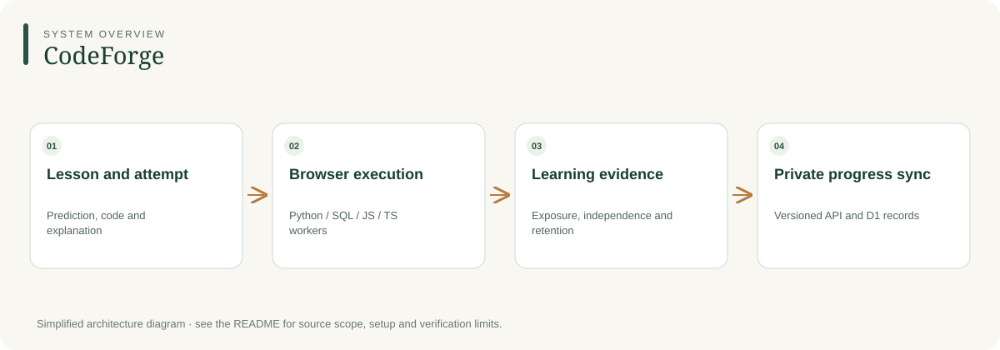

# CodeForge

An installable coding learning app with browser execution, spaced review, and private progress synchronization.

I built CodeForge to connect short lessons with actual attempts: read a small example, predict behavior, write or fix code, then explain what happened. Learning evidence stays separate from XP and repeated practice.

## What it does

- Provides Python, SQL, JavaScript, TypeScript, React/Next.js, AI, retrieval, and shipping lessons.
- Executes supported exercises through browser workers and isolated previews.
- Tracks first attempts, help use, problem families, and delayed review separately.
- Keeps drafts, independent classes, private workspaces, and recoverable account-sync conflicts.
- Includes a multi-file briefing-assistant project and exportable starter.

## Architecture

React/TypeScript application and curriculum → isolated browser runtimes → versioned attempt summaries → private account API and Cloudflare D1 persistence.

Python uses Pyodide; SQL uses sql.js/SQLite; component exercises use an isolated React preview. Browser exercises do not execute learner code on the application server. The built-in retrieval demonstration returns lexical source evidence; it is not a live generative RAG system.

## A design decision

A stopped or unavailable runner is not a wrong answer. Help already viewed still exposes that problem family. [Selected source excerpt](examples/family-exposure.mjs) shows this distinction without publishing accounts, full curriculum, answer banks, or backend implementation.

## Open and review

[Application](https://codeforge-practice.bronsonohatch.chatgpt.site) · [Portfolio](https://bronsonhatch.com)

The application is owner-private and requires an authorized account. This public repository is a case study and selected source excerpt; it does not grant access or contain a runnable copy of the service. Full application source remains private.

The source project documents Node 22.13+, `npm ci`, `npm test`, and `npm run build`. These commands require the private source tree. This showcase has no dependency install or deployment step.

## Evidence and limits

The source project includes learning/persistence tests and real browser-runtime checks. No fresh full application test run is claimed by this documentation package. Physical iPhone Safari/installed-app checks, VoiceOver, and independent editorial review of assessment equivalence remain explicit gates. Finite question-bank completion does not certify proficiency or employment readiness.

Original application/course content is combined with separately licensed runtimes: Pyodide, SQLite/sql.js, TypeScript, and React. Their notices remain in the application; no runtime binaries or third-party implementations are redistributed here.

[Use and attribution](USE-AND-ATTRIBUTION.md).

